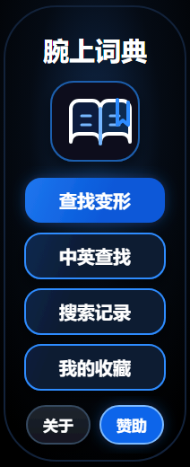

  

<h1 align="center">腕上词典</h1>

  <em>小米手环上的离线英汉词典 — 抬手即查，无需掏手机</em>

  
  
  
  
  
  
  

---

## 简介

**腕上词典** 是一款运行在小米手环 / 手表上的 Vela 快应用，把一部离线英汉词典装进手腕：英汉互查、词形变化反查、模糊搜索、收藏与历史，全程无需联网。基于小米 `aiot-toolkit` 构建。

为了适配不同屏幕，本仓库按分辨率拆成 **5 个独立分支**，每个分支只服务自己那块屏，各自构建、互不影响。

> ⚠️ **当前 `master` 分支是 2.3.1 时期的单包历史版本**，仅用于追溯早期实现。**最新 3.2.0 代码在下面 5 个分辨率分支里**，请切换分支查看。

## 分支一览

| 分支 | 屏幕 | 形态 | 包名 | 词库档位 | 词头数 | 适配机型 |
|------|------|------|------|----------|--------|----------|
| [`w192`](https://github.com/pcai7296/com.watch.dic/tree/w192) | 192×490 | 胶囊屏 | `com.watch.dic.w192` | standard | 70,408 | 小米手环 9 |
| [`w212`](https://github.com/pcai7296/com.watch.dic/tree/w212) | 212×520 | 胶囊屏 | `com.watch.dic.w212` | dev | 1,400 | 小米手环 10 / 10 NFC |
| [`w336`](https://github.com/pcai7296/com.watch.dic/tree/w336) | 336×480 | 矩形屏 | `com.watch.dic.w336` | standard | 70,408 | 小米手环 9 Pro / 10 Pro |
| [`w432`](https://github.com/pcai7296/com.watch.dic/tree/w432) | 432×514 | 矩形屏 | `com.watch.dic.w432` | standard | 70,408 | 红米手表 5 / 5 X Ring / 6 |
| [`w466`](https://github.com/pcai7296/com.watch.dic/tree/w466) | 466×466 | 圆屏 | `com.watch.dic.w466` | standard | 70,408 | 小米手表 S4 |

> 词头数取自各分支 `src/common/dict/meta.json`；**发行包**（AstroBox 发布仓库中的 3.2.0 安装包）统一为 lite 档（19,942 词头）。w212 为 dev 调试档，其余 4 支为 standard 全量档。

## 安装

普通用户请用 **AstroBox**，从发布仓库 [pcai7296/com.watch.dic_AstroBox_Release](https://github.com/pcai7296/com.watch.dic_AstroBox_Release) 安装对应机型的分辨率包（lite 档，适配机型见上方「分支一览」）。

开发者从源码构建：切换到对应分支后 `npm install`，再按该分支 README 的说明构建。

## 功能

- **🔍 三种查词** — 英文精确 / 前缀匹配、中文单字与词组、词形变化反查
- **⌨️ 内置英文输入法** — QWERTY 全键盘、光标编辑、自动补全；连点 3 次搜索框切换大键盘
- **✨ 智能补全** — 按 1–2 个首字符取分片异步加载，标注考试标签（中考 / 高考 / CET-4 / CET-6 / 考研 / TOEFL / IELTS / GRE）
- **🌀 模糊搜索** — 编辑距离 ≤ 2，单次最多扫描 4,000 行、候选池 80 条，输错也能找到
- **📖 词形反查** — `ran` → run、`better` → good
- **❤️ 收藏与历史** — 收藏上限 150 条（A-Z 筛选、分页浏览），历史自动缓存 20 条
- **📄 分页结果** — 每页 20 条，翻到页尾自动滚屏
- **🌙 深色主题** — 深蓝底 `#020813` + 蓝色强调 `#1d74e8`
- **🔆 屏幕常亮** — 设置中可开关，查词时不再自动熄屏
- **📴 纯离线** — 词典分片随仓库提交，无需联网、无数据库

## 版本

- **3.2.0**（2026-11-01）：冷启动峰值下降、新增「屏幕常亮」、首页时间按分钟校正、新应用图标、首页侧滑退出修复。详见各分辨率分支的 `CHANGELOG.md`。
- 各分支版本号以 `src/manifest.json` 的 `versionName` / `versionCode` 为准。

## 许可

3.2.0 起采用 **非商业署名许可 1.0（WD-NCA-1.0）**，完整条款见各分辨率分支的 `LICENSE`：允许自由使用、复制、修改与分发，但**仅限非商业目的**；分发时必须保留署名并注明修改；禁止售卖、付费下载、广告变现、预装搭售等商业使用。

词库数据来自 [ECDICT](https://github.com/skywind3000/ECDICT)、CC-CEDICT、BNC/COCA 词族。

## 相关仓库

- **AstroBox 发布仓库** — [pcai7296/com.watch.dic_AstroBox_Release](https://github.com/pcai7296/com.watch.dic_AstroBox_Release)：lite 档安装包、机型清单与校验信息。
